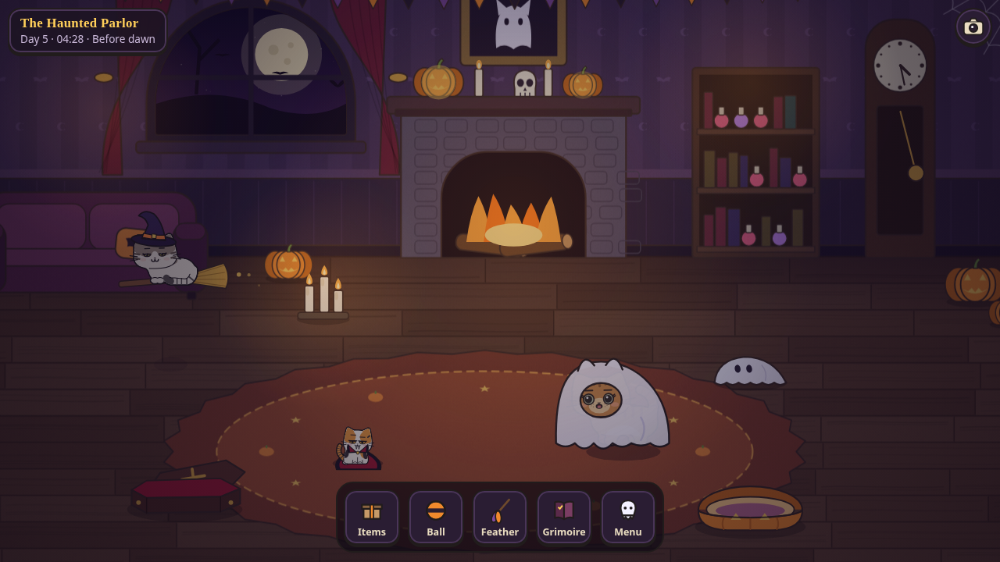

# NekoGaku: Kiroween edition

A haunted cat house stitched to a Japanese grimoire. You study JLPT N5 to N1, or Japanese for the Specified Skilled Worker (SSW) jobs in nursing care and food manufacturing, and every quiz you finish feeds EXP to one of three cats: Cecil, Kuku and Bolu. Give them a coffin, a ghost sheet or a broom and they become a vampire, a ghost or a flying witch.

Built for [Kiroween 2026](https://kiroween.devpost.com/), category **Frankenstein**, with Kiro CLI.



## What is inside

**The haunted house** (`/`)

- One Halloween living room, lit by an arcade clock: one in-game day is 10 real minutes, from dusk to the witching hour and back.
- Three cats drawn entirely in code by a procedural rig (no sprite sheets). They wander, groom, nap, hop on the sofa, chase a ball and stalk a feather. Tap to pet, hold to carry.
- Fifteen Halloween items, each one also a Japanese word with its voice. Five are open from the start; the other ten open once all seven mock exams are passed with 80% or more.
- Six of them dress a cat up for a while: vampire (cape, collar, fangs), ghost (a floating sheet with the cat's own face), werewolf (wolf ears, mane, a howl), bat (flies around the room), witch (hat, flies on the broom) and mummy (wrapped in bandages). The rest of the time the cats look like themselves.
- Bottom bar: Items, Ball, Feather, Grimoire and Menu. The camera is in the top right.
- A gym without a gym room: send a cat from the Menu (Cats tab) and it lifts a barbell in front of the fireplace.
- Photos with a Halloween frame and an album of the last 12.
- Two stats per cat, nothing else: EXP (level 1 kitten to level 15 senior, the cat grows) and Love (10 hearts).

**The grimoire** (`/study`)

- JLPT N5, N4, N3, N2, N1 from OpenJLPT: the full vocabulary, kanji and grammar lists of each level, cut into units of 20 words or kanji and 5 grammar points.
- SSW Kaigo (nursing care) and SSW Food (food and beverage manufacturing): 16 units written in English for this app, with the Japanese key terms and scenario questions.
- Every unit: study cards with VOICEVOX audio, then a 10-question quiz. Every answer is explained, and a wrong pick says what that option actually means.
- A mock exam per track: 20 mixed questions, a 10-minute clock, then a review of every question.
- A score of 80% seals a unit. The EXP waits on the server and the house hands it to your study buddy cat.

**Login** (`/login`): sign in with an access code (`NEKO-XXXX-XXXX`). Your cats and your progress follow the code to any device.

## Why "Frankenstein"

Four parts that normally never meet, sewn into one app:

| Part | What it is |
| --- | --- |
| A pet simulation | TypeScript on Canvas 2D: a procedural cat rig with poses, gaits, emotions and costumes as overlays, a small behaviour brain |
| A curriculum engine | SQLite through libSQL, SQL migrations, a seed that turns open JSON data into 563 units, a deterministic quiz builder |
| A neural voice | VOICEVOX running in Docker, used offline in a batch to render every Japanese word and example to MP3 |
| A synthesizer | A DSP music engine in TypeScript (oscillators, plucked strings, bells, reverb, loudness) that composes the two Halloween tracks without samples |

The thread between them is thin on purpose: a quiz score becomes EXP, an item becomes a word.

## Run it

Node 22+, ffmpeg (only for building audio).

```bash
npm install
npm run setup                    # migrations + seed the curriculum into .data/nekogaku.sqlite
npm run codes -- new 1 "Me"      # prints an access code (shown once)
npm run dev                      # http://localhost:3000, then enter the code
```

The voice clips and music are in the repo. To rebuild them:

```bash
docker run -d --rm --name nekogaku-voicevox -p 127.0.0.1:50021:50021 voicevox/voicevox_engine:cpu-latest
npm run voice:build              # incremental, about 2 clips a second on a desktop CPU
npm run db:seed                  # links the new clips to the cards
npm run music:build              # renders public/audio/music/*.mp3
```

Checks:

```bash
npm test                         # property-based tests (fast-check)
npm run game:check               # TypeScript for game/
npm run content:check            # every unit valid, no Indonesian left, no third-party assets
npm run build
```

Deploying on a VPS: `deploy/nekogaku-kiroween.service` (systemd) and `deploy/nginx.conf`. Register codes on the server with `npm run codes -- add NEKO-XXXX-XXXX "Label"`.

## How Kiro was used

The full write-up is in [docs/KIRO.md](docs/KIRO.md). In short: the spec in `.kiro/specs/nekogaku-kiroween/` (requirements in EARS form, design, tasks) drove the build; steering in `.kiro/steering/` held the product rules; hooks in `.kiro/hooks/` type-check the game on save, check the curriculum on data changes, run the property tests at the end of each turn, and keep the owner's main project read-only.

## Earlier code in this project

Kiroween asks for new projects and for a declaration of earlier code. This repository was started during the submission period. One part was brought in from the author's private, larger NekoGaku app: the procedural cat rig in `game/art/` (the cats' look, body mould, poses, walking frames, clips, emotions, emote marks, barbell prop). Everything else (the room, the items, the costumes, the simulation, the arcade clock, the grimoire, the database, accounts, the voice and music pipelines as used here, all tests and all `.kiro` files) was written for this repository. The music synthesizer started from the author's earlier script and was rewritten for the two Halloween pieces.

## Credits

- Japanese voices: **VOICEVOX:四国めたん**, generated with the [VOICEVOX](https://voicevox.hiroshiba.jp/) Engine.
- JLPT data: [OpenJLPT](https://github.com/evanclan/OpenJLPT), CC BY-SA 4.0, built on JMdict/EDICT and KANJIDIC2 (EDRDG), Jonathan Waller's JLPT lists and Tatoeba.
- Agent skills: [antislop](https://github.com/miqdadbadjuber/anti-slop) (MIT), used as the filter for UI, copy and comments.
- Cats, room, items, costumes, music and sound effects: made in code for NekoGaku.

## License

Code: MIT ([LICENSE](LICENSE)). Data and media: see the end of the LICENSE file.
